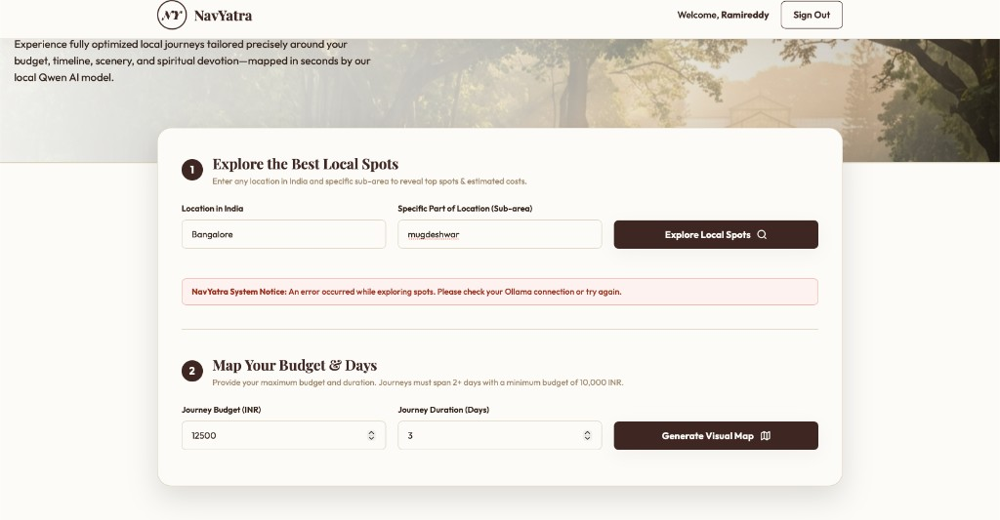

# NavYatra

**NavYatra** is a Django travel planner for local journeys in India. It uses a **local Qwen 2.5** model via **Ollama** (no cloud API keys) to suggest spots and build budget-aware day-by-day itineraries.



## Features

- Register / login with admin approval workflow
- **Explore Local Spots** — AI picks top places for a city + sub-area
- **Generate Visual Map** — multi-day plan under your INR budget (min ₹10,000, 2+ days)
- Export itinerary as PNG

## Quick start (one command after setup)

```bash
chmod +x scripts/setup.sh scripts/start.sh
./scripts/setup.sh    # once: Ollama model + Python + DB
./scripts/start.sh    # Ollama + Django at http://127.0.0.1:8000/
```

Open **http://127.0.0.1:8000/entry/** to sign in or register.

## AI stack (local, fast)

| Item | Value |
|------|--------|
| Runtime | [Ollama](https://ollama.com) |
| Default model | `qwen2.5:latest` |
| Compatibility alias | `qwen2.5:3b` → `qwen2.5:latest` after setup |
| Request timeout | **600 seconds** (server + browser) |
| Model keep-alive | **30 minutes** (fewer cold starts) |

Larger model (slower, more detail):

```bash
export OLLAMA_MODEL=qwen2.5:7b
ollama pull qwen2.5:7b
./scripts/start.sh
```

## Health check

```bash
curl http://127.0.0.1:8000/api/health/
```

Example when OK:

```json
{"ok": true, "model": "qwen2.5:latest", "timeout_sec": 600}
```

## Project layout

```
NavYatra/
├── manage.py
├── navyatra/              # Django app (views, AI helper, templates, static)
├── navyatra_project/      # Django settings
├── scripts/
│   ├── setup.sh           # Install deps + pull Qwen model
│   └── start.sh           # Run Ollama + Django
├── docs/screenshots/      # README images
└── requirements.txt
```

## Environment variables

| Variable | Default | Purpose |
|----------|---------|---------|
| `DJANGO_SECRET_KEY` | Development-only fallback | Django signing key; set a private value before deployment |
| `OLLAMA_MODEL` | `qwen2.5:latest` | Model name in Ollama |
| `OLLAMA_TIMEOUT_SEC` | `600` | Max seconds per AI call |
| `OLLAMA_KEEP_ALIVE` | `30m` | Keep model loaded in RAM |
| `OLLAMA_API_URL` | `http://127.0.0.1:11434/api/generate` | Ollama generate endpoint |

## Troubleshooting

| Symptom | Fix |
|---------|-----|
| “Ollama is not running” | Run `./scripts/start.sh` or `ollama serve` |
| “Model … is not pulled” | Run `./scripts/setup.sh` |
| First request slow | Normal — model loads once; later calls are faster |
| Timeout on itinerary | Use fewer days or raise `OLLAMA_TIMEOUT_SEC` |

Ollama logs (when started via script): `/tmp/navyatra-ollama.log`

## Admin

Create a superuser to approve registrations:

```bash
source .venv/bin/activate
python manage.py createsuperuser
```

Admin site: **http://127.0.0.1:8000/admin/**

## Tech

- Python 3 + Django 4.2
- SQLite
- Ollama + Qwen 2.5 (JSON mode, token limits for speed)

---

*NavYatra — local journeys, mapped by your machine.*
